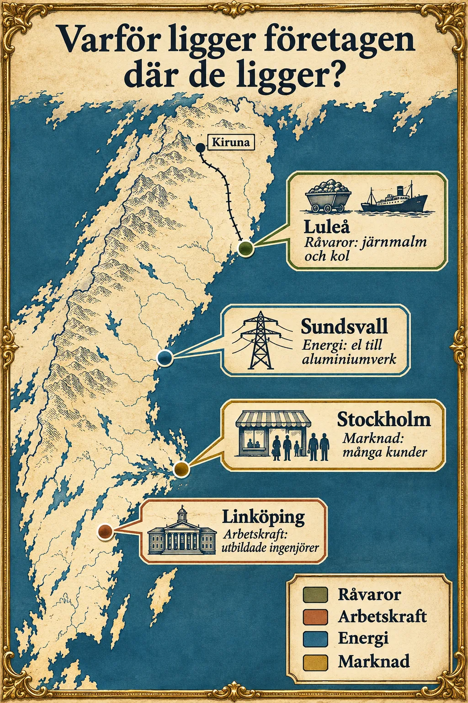

## Varför ligger företag där de ligger?

> - Lokaliseringsfaktorer avgör var ett företag ligger.
> - Fyra viktiga: närhet till råvaror, arbetskraft, energi och marknaden.

Varför ligger sågverk ofta nära skogen? Varför finns teknikföretag ofta i städer med universitet? Ett företag kan inte ligga var som helst. Det som avgör var ett företag placerar sin verksamhet kallas **lokaliseringsfaktorer**. Ett företag vill ligga där det kan tjäna mest pengar. Vad som är viktigast beror på vad företaget gör.

👁 Titta på bilden – Lokaliseringsfaktorer i Sverige

Kartan visar fyra platser i Sverige. Varje plats är ett exempel på en lokaliseringsfaktor. Lägg märke till:

<ul>
<li><strong>Luleå</strong>: här finns <strong>råvaror</strong> – järnmalm kommer med tåg och kol med båt</li>
<li><strong>Linköping</strong>: här finns <strong>arbetskraft</strong> – många utbildade ingenjörer</li>
<li><strong>Sundsvall</strong>: här finns <strong>energi</strong> – mycket el till aluminiumverket</li>
<li><strong>Stockholm</strong>: här finns <strong>marknaden</strong> – många kunder</li>
</ul>

Fundera: Vilken lokaliseringsfaktor tror du är viktigast för företagen där du bor?

<figure class="brodtext-bild enkel">

<figcaption>Fyra lokaliseringsfaktorer i Sverige.</figcaption>
</figure>

## 1. Närhet till råvaror

### Tunga och stora råvaror

Det kostar mycket att frakta tunga saker. Stockar från skogen är stora och tunga. Därför ligger sågverken ofta nära skogen. Där sågas stockarna till brädor, som är lättare att frakta vidare. Sockerbetor är också tunga, så sockerbruken ligger nära åkrarna där betorna växer.

### Mellan flera råvaror

Ibland behöver en fabrik flera råvaror från olika platser. Stålverket i Luleå behöver både järnmalm och kol. Järnmalmen kommer med tåg från Malmfälten. Kolet kommer med båt till hamnen. Luleå har både järnväg och hamn, och därför fungerar platsen bra.

## 2. Närhet till arbetskraft

### Utbildad arbetskraft

Vissa företag behöver anställda som har studerat länge, till exempel ingenjörer och forskare. Därför ligger de gärna nära ett universitet. Saab ligger i Linköping, nära universitetet, och i Kista i Stockholm finns många IT-företag. När många liknande företag finns på samma plats kan de lära sig av varandra.

### Billig arbetskraft

Att sy kläder kräver mycket arbete för hand. Därför har många klädföretag flyttat sina fabriker till länder där lönerna är låga, som Bangladesh, Indien, Kina och Vietnam. Det gör kläderna billigare, men de som arbetar där har ofta långa dagar och farliga arbetsplatser. Nu flyttar vissa företag hem igen, och när robotar gör mer av jobbet spelar låga löner mindre roll.

## 3. Närhet till energi

### Historiska energikällor

Förr drevs många fabriker med strömmande vatten. Därför byggdes kvarnar, sågverk och järnbruk vid forsar. För att göra järn behövdes också träkol från skogen, så många järnbruk växte upp i skogen. Många av fabrikerna låg kvar där även när energin senare kom från något annat.

### Billig energi

Det går åt väldigt mycket el för att göra aluminium. Därför vill aluminiumfabriker ligga där elen är billig. Island har billig el från vattenkraft och från värmen inne i jorden, och där finns stora aluminiumfabriker fast råvaran måste fraktas dit. I Sverige finns en aluminiumfabrik i Sundsvall.

## 4. Närhet till marknaden

### Tunga slutprodukter

Marknaden är de som köper varorna. Läsk är mest vatten, och vatten är tungt. Därför fraktar man bara smaken och blandar läsken nära kunderna. Av liknande skäl har biltillverkare fabriker i många delar av världen.

### Färskvaror

Mjölk och bröd blir snabbt dåligt. Därför har mejerier och bagerier ofta legat nära städerna. I dag finns kylbilar, så de kan fraktas längre.

### Nära kontakt med kunden

En frisör eller en restaurang måste finnas där kunderna är. En bank kan däremot hjälpa sina kunder via internet, var de än bor.

## Flera faktorer påverkar placeringen

Oftast är det flera saker som avgör var ett företag hamnar. Företaget väljer den plats som är bäst sammantaget. Det som är en bra plats i dag kan också bli sämre i morgon, till exempel när ny teknik kommer.

> - Råvaror: tunga råvaror förädlas nära källan.
> - Arbetskraft: utbildad eller billig. Energi: förr vattenkraft, i dag billig el.
> - Marknaden: tunga produkter, färskvaror och tjänster nära kunderna.
