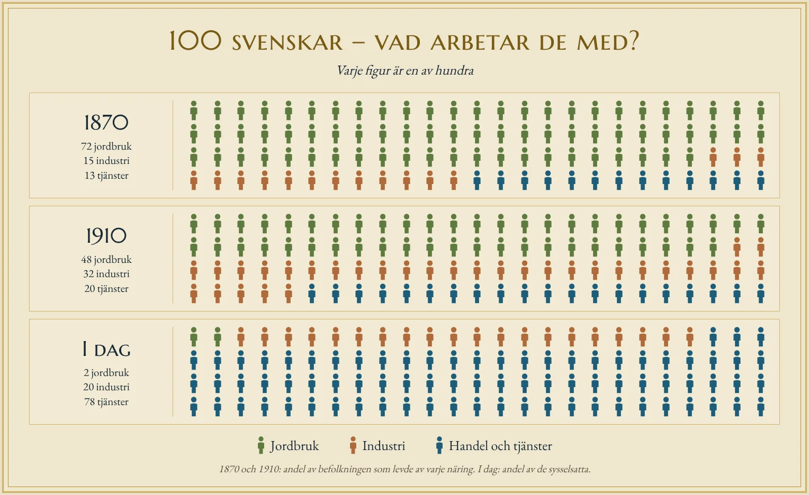

# Sveriges näringsliv

## Sverige var länge ett land där de flesta levde av jordbruket

Under 1850-talet var Sverige fortfarande ett jordbruksland. Omkring 80 procent av befolkningen levde av jordbruket, och många producerade främst mat för det egna hushållet. De flesta människor bodde på landsbygden och arbetade med att odla jorden eller sköta djur.

Jordbruket började förändras genom nya odlingsmetoder, bättre redskap och effektivare arbetsorganisation. När större skördar kunde produceras med mindre arbetskraft behövdes inte lika många människor inom jordbruket. Därför kunde fler söka arbete inom andra delar av näringslivet.

Förändringen gick gradvis. År 1870 levde fortfarande drygt 70 procent av befolkningen av jordbruket, men 1920 hade andelen minskat till omkring 45 procent. Sverige höll på att förändras från ett jordbruksland till ett industriland.

## Industrin växte när jordbruket moderniserades

Från 1850-talet började den svenska industrin utvecklas snabbt. Denna förändring kallas **industrialisering** och innebar att allt fler varor tillverkades i fabriker med hjälp av maskiner. Industrin behövde arbetskraft, och många människor lämnade landsbygden för att arbeta i växande industristäder.

Sverige hade god tillgång till skog, järnmalm och vattenkraft. Dessa naturresurser gav industrin viktiga förutsättningar att utvecklas. Samtidigt förbättrades transporterna, vilket gjorde det lättare att frakta råvaror och sälja färdiga produkter.

Industrialiseringen skedde i flera steg:

- 1850–1870 växte sågverken, järnbruken och textilindustrin.
- 1870–1890 byggdes järnvägarna ut, stålindustrin utvecklades och exporten ökade kraftigt.
- 1890–1914 expanderade verkstadsindustrin med tillverkning av maskiner och tekniska produkter.
- 1914–1950 utvecklades tillverkningen av bilar och många nya maskiner.
- 1950–1970 upplevde svensk industri en storhetstid med kraftigt växande produktion och export.

Industrins tillväxt förändrade hela samhället. Nya arbetstillfällen skapades, städerna växte och Sverige kunde sälja allt fler industriprodukter till andra länder. Exportinkomsterna bidrog till att höja levnadsstandarden och utveckla landets ekonomi.

Under industrialiseringen grundades många av de företag som fortfarande hör till Sveriges största. Senare har nya företag tillkommit. Tabellen visar några av dem.

| Företag | Grundades | Vad företaget gör |
|---|---|---|
| Sandvik | 1862 | Stål, verktyg och maskiner för gruvor och industri |
| Atlas Copco | 1873 | Kompressorer och verktyg för industrin |
| Ericsson | 1876 | Utrustning för mobilnät och telekommunikation |
| ASSA (i dag ASSA ABLOY) | 1881 | Lås och säkerhetssystem |
| ASEA (i dag ABB) | 1883 | Elektrisk utrustning och industrirobotar |
| Alfa Laval | 1883 | Separatorer, värmeväxlare och pumpar |
| LKAB | 1890 | Bryter järnmalm i Kiruna och Malmberget |
| Scania | 1891 | Lastbilar, bussar och motorer |
| SKF | 1907 | Kullager |
| Electrolux | 1919 | Hushållsmaskiner, till exempel spisar och dammsugare |
| Volvo | 1927 | Lastbilar, bussar och anläggningsmaskiner |
| Saab | 1937 | Flygplan och försvarsutrustning |
| IKEA | 1943 | Möbler och heminredning |
| H&M | 1947 | Kläder |
| Tetra Pak | 1951 | Förpackningar för mat och dryck |
| Klarna | 2005 | Betaltjänster för handel på internet |
| Spotify | 2006 | Strömning av musik och poddar |

## Maskiner och automatisering minskade behovet av industriarbetare

Under industrins storhetstid arbetade många svenskar inom den sekundära sektorn. Fabrikerna behövde stora mängder arbetskraft för att tillverka bilar, maskiner, stål och andra produkter.

Med tiden blev industrin alltmer effektiv. Genom **automatisering** kunde maskiner och robotar utföra arbetsuppgifter som människor tidigare hade gjort. Företagen kunde därför öka produktionen utan att behöva anställa lika många arbetare.

Samtidigt ökade konkurrensen från andra länder. Vissa företag flyttade delar av tillverkningen utomlands, där produktionskostnaderna kunde vara lägre. Andra satsade på avancerad teknik och tillverkning som krävde färre men mer specialiserade anställda.

I dag arbetar omkring 12 procent av de sysselsatta i Sverige inom tillverkningsindustrin. Industrin har fortfarande stor betydelse för Sveriges ekonomi och export, trots att betydligt färre människor arbetar där än tidigare.

## Tjänstesektorn växte och blev den största delen av näringslivet

När jordbruket och industrin blev effektivare minskade behovet av arbetskraft inom dessa sektorer. Samtidigt ökade människors inkomster och efterfrågan på handel, transporter, utbildning, sjukvård och andra tjänster.

Den offentliga sektorn byggdes också ut och skapade många arbetstillfällen inom exempelvis skola, vård och omsorg. Dessutom började företag köpa fler tjänster från andra företag, bland annat inom ekonomi, informationsteknik och transporter.

Sverige utvecklades därför till ett **tjänstesamhälle**, där de flesta sysselsatta arbetar inom tjänstesektorn i stället för inom jordbruket eller industrin.

I dag är fördelningen mellan sektorerna ungefär följande:

- Jordbruk, skogsbruk och fiske sysselsätter omkring 2 procent.
- Industri och byggverksamhet sysselsätter ungefär en femtedel.
- Tjänster sysselsätter omkring tre av fyra.

Den kvartära sektorn räknas oftast in i tjänsterna när sysselsättningen redovisas.

<figure class="brodtext-bild standard">

<figcaption>100 svenskar 1870, 1910 och i dag. För 1870 och 1910 visas hur stor del av befolkningen som levde av varje näring, för i dag hur de sysselsatta fördelas.</figcaption>
</figure>

## Nya företag växer genom idéer, handel och teknik

Sveriges näringsliv förändras också genom att nya företag skapas. En **entreprenör** är en person som utvecklar en affärsidé och startar eller bygger upp en verksamhet. En framgångsrik idé kan göra att ett litet företag växer och börjar sälja sina produkter eller tjänster i andra länder.

IKEA, som grundades 1943, utvecklade en affärsidé med möbler som kunderna själva transporterar och monterar. H&M, som grundades 1947, växte genom att sälja kläder till en bred marknad. Båda företagen utvecklades till internationella handelsföretag.

Digitaliseringen har skapat nya möjligheter att starta företag. Klarna, som grundades 2005, utvecklade digitala betaltjänster för handel på internet. Spotify, som grundades 2006, byggde sin verksamhet kring strömning av musik via internet.

Dessa företag visar hur affärsidéer kan utvecklas till internationella verksamheter. I dag behöver ett framgångsrikt företag inte äga stora fabriker. Kunskap, teknik, digitala tjänster och förmågan att nå kunder kan vara minst lika viktiga.

Sverige har gått från jordbruksland till industriland och vidare till tjänstesamhälle, samtidigt som den kvartära sektorn med kunskap, forskning och teknik blir allt viktigare.